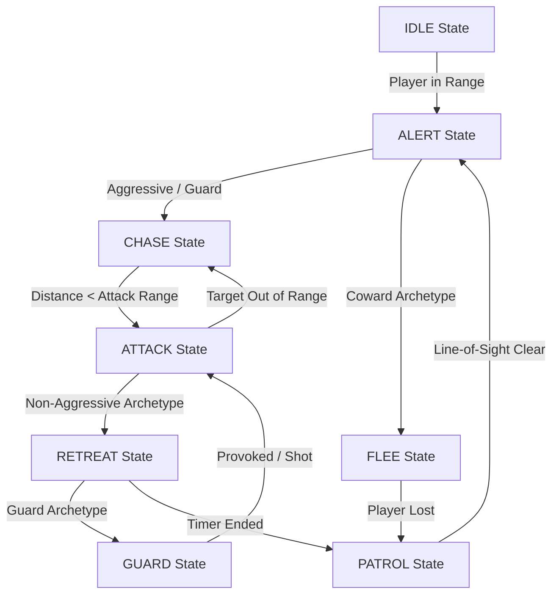

# 🎮 Python 2D Adventure Game with Intelligent NPCs

An action-adventure platformer built with **Python** and **Pygame**, featuring dynamic **Intelligent NPCs** driven by a **Finite State Machine (FSM)** engine, rule-based AI, line-of-sight raycasting, multi-stage levels, quest systems, and leveling.

---

## 📌 Project Overview

Unlike traditional 2D games where enemies follow simple, fixed path scripts, this project implements artificial intelligence techniques that enable NPCs to perceive their environment, track player line-of-sight through solid obstacles, and dynamically adjust their behavior based on distance, personality traits, and combat situations.

---

## ✨ Key Features

### 🧠 Intelligent NPC & AI Engine
- **8-State Finite State Machine (FSM)**: NPCs transition dynamically between `IDLE`, `PATROL`, `ALERT`, `CHASE`, `ATTACK`, `RETREAT`, `FLEE`, and `GUARD`.
- **4 Personality Archetypes**:
  - ⚔️ **AGGRESSIVE**: Relentlessly pursues and counter-attacks when damaged.
  - 🛡️ **GUARD**: Maintains defensive posture, tucking into invulnerable armor until provoked.
  - 🏃 **COWARD**: Flees from the player at high speed when taking damage or alerted.
  - 🤝 **SUPPORT / FRIENDLY**: Provides dialogue hints and quest objectives.
- **Line-of-Sight (LoS) Raycasting**: Enemies cannot see the player through solid map terrain tiles.
- **Visual AI Overlay**: Real-time debug indicators show current FSM states above enemy heads along with an AI legend HUD.
- **3-Phase Boss FSM**: Features a multi-stage boss that alters speed, color, attack rate, and bullet patterns across 3 distinct combat phases as its health decreases.

---

### 🗺️ Adventure & Progression Mechanics
- **Multi-Stage Progression**:
  1. *Stage 1-1: Grassland Corridor*
  2. *Stage 1-2: Underground Cavern*
  3. *Stage 1-3: Boss Fortress Arena*
- **70% Defeat Exit Requirement**: Stages require defeating at least 70% of local enemies to unlock the stage exit door.
- **Quest System**: Active quest tracker for stage progression, key collecting, and boss defeat.
- **Inventory & Consumables**: Open inventory with `[I]`, use Health Potions with `[1]` to restore health.
- **XP & Leveling System**: Defeating enemies grants XP, leveling up player stats (Max HP and Attack Damage).
- **Checkpoints & Keys**: Save points restore health on defeat; Golden Keys unlock locked gates.
- **Particle System**: Dynamic visual effects for jumps, damage hits, level ups, and item pickups.

---

## 🕹️ Controls

| Action | Primary Key | Secondary Key |
|---|---|---|
| **Move Left** | `A` | `Left Arrow` |
| **Move Right** | `D` | `Right Arrow` |
| **Jump** | `W` | `Up Arrow` |
| **Shoot** | `Space` | `X` |
| **Interact / Talk** | `E` | — |
| **Toggle Inventory** | `I` | — |
| **Use Health Potion** | `1` *(in inventory)* | — |
| **Restart Game** | `Enter` *(on Game Over)* | — |

---

## 🏗️ Codebase Architecture

```
AdvetureGame/
│
├── main.py                   # Game entry point & main loop driver
├── try.py                    # Backward-compatible launch wrapper
├── config.py                 # Game constants, UI colors, physics & AI states
├── assets.py                 # Image asset manager & procedural fallback loader
├── particles.py              # Visual particle physics engine
├── game_manager.py           # World manager, stage loading, update & render loops
├── tile_map.py               # Map grid layouts & stage data
├── enemy_collision.py        # Enemy tile and wall collision resolution
│
├── systems/                  # Core game sub-systems
│   ├── quest.py              # Quest tracking & reward system
│   ├── inventory.py          # Inventory management & consumable usage
│   └── interactive.py        # Checkpoints, Keys, Doors, Tiles, Friendly NPCs
│
└── entities/                 # Game character & AI hierarchy
    ├── player.py             # Player movement, shooting, animations & leveling
    ├── ai_base.py            # IntelligentNPC base class (FSM engine & LoS raycasting)
    ├── metall.py             # Metall enemy & projectile behavior
    ├── blader.py             # Flying Blader enemy with swooping attack AI
    └── boss.py               # 3-Phase Boss Enemy state machine
```

---

## 🤖 AI State Machine Flowchart



---

## 📦 Requirements & Installation

### Prerequisites
- **Python**: Version 3.8 or higher installed on your system.
- **Pygame**: Version 2.0 or higher.

### Installation Steps

1. **Clone or Download the Repository**:
   ```bash
   git clone https://github.com/Oladelesunkanmi/AdvetureGame.git
   cd AdvetureGame
   ```

2. **Install Required Dependencies**:
   ```bash
   pip install pygame
   ```

3. **Run the Game**:
   ```bash
   python main.py
   ```
   *or*
   ```bash
   py try.py
   ```

---

## 📜 License
This project is developed as part of an academic game development project demonstrating Intelligent NPC behavior using Finite State Machines in Python. Free for educational and learning purposes.
